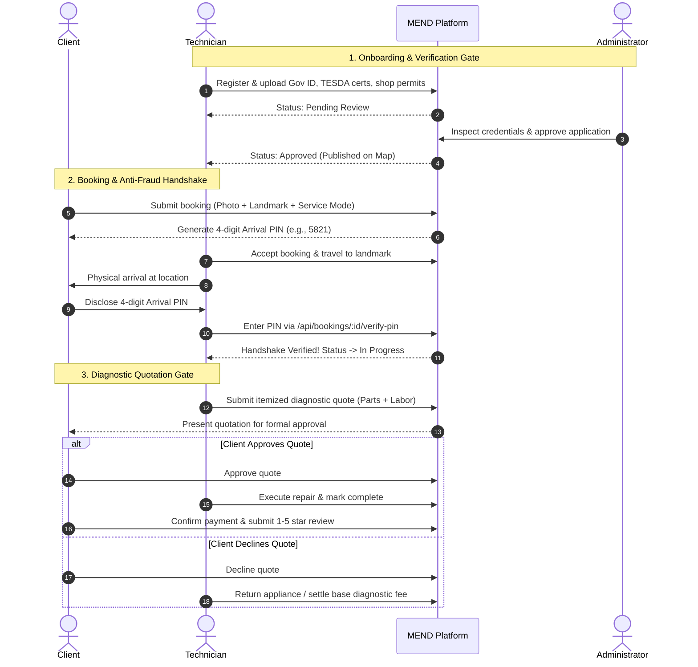

# MEND — Maintenance Experts Near your Door

> **Comprehensive System Architecture, Problem Analysis, and Real-Life Solution Matrix**  
> *Target Region:* Ilocos Norte, Philippines
> *Stack:* React 19 PWA, Node.js Express API, Supabase (PostgreSQL + Auth + Storage), Mapbox GL, PayMongo  

---

## 1. Executive Summary & System Overview

**MEND** is a service marketplace engineered to bridge the trust, safety, and logistical gap between everyday households/appliance owners and verified local repair technicians (**Repair Pros**).

In provincial and semi-urban settings like Ilocos Norte, appliance and electronics repair has historically been trapped in an informal, unregulated word-of-mouth economy. MEND digitizes, standardizes, and secures this lifecycle through:

1. **Multi-Service Fulfillment**: Home Service (on-site repair), Pickup & Delivery, and Walk-In (customer drop-off at workshop).
2. **Mandatory Credential Vetting**: Administrative review of Government IDs, TESDA trade certifications, and shop permits before any technician is dispatched.
3. **Anti-Fraud & Proof-of-Arrival Handshake**: 4-digit arrival handshake PINs, mandatory fault photos, landmark descriptions, and customer reliability scoring to eliminate fake/ghost bookings.
4. **Diagnostic-to-Quotation Pipeline**: Built-in two-stage repair flow requiring itemized customer sign-off (parts + labor) before physical work begins, eliminating hidden fees.
5. **Operational Accountability**: Real-time direct messaging, dispute ticket management with full evidentiary audit trails, customer rating/review engine, and automated technician wallet balances.

---

## 2. Real-Life Problems the System Solves

```
                             THE MARKET GAP
   INFORMAL REALITY                                      MEND PLATFORM
 ┌─────────────────────────┐                           ┌─────────────────────────┐
 │ • Unvetted strangers    │                           │ • Verified TESDA pros   │
 │ • Price gouging         │   ───────────────►        │ • Itemized quotes       │
 │ • Ghost / fake bookings │     REPLACES              │ • 4-digit Handshake PIN │
 │ • Disappearing techs    │                           │ • Audit logs & reviews  │
 └─────────────────────────┘                           └─────────────────────────┘
```

### A. Real-Life Problems Faced by Clients (Households & Appliance Owners)

> [!WARNING]
> **The "Stranger in My House" Safety Hazard**  
> Large appliances (refrigerators, split-type air conditioners, washing machines) cannot easily be transported and require "Home Service." In the informal market, homeowners must invite an unvetted stranger found on Facebook into their private residence with no identity records, background checks, or recourse in case of theft or damage.

1. **Diagnostic Extortion & Hidden Pricing**:
   - Technicians often quote a low inspection fee, dismantle the unit, and then demand exorbitant amounts for replacement parts or reassembly while the machine sits in pieces.
   - Customers have no prior visibility into standard labor rates or actual component market prices.
2. **Disappearing Technicians on "Back Jobs"**:
   - When an appliance breaks down again 48 hours later, informal handymen frequently ignore calls, block phone numbers, or refuse to honor verbal warranties (*"walang resibo, walang warranty"*).
3. **Skill Mismatch & Damaged Valuables**:
   - General handymen often claim expertise in modern inverter appliances or micro-electronics without proper training. Incompetent attempts frequently ruin costly control boards or create fire hazards.
4. **Geographic & Scheduling Friction**:
   - Finding out which technician is available today and willing to travel to an outlying or coastal barangay requires dozens of phone calls with unpredictable response times.

---

### B. Real-Life Problems Faced by Repair Professionals (Technicians)

> [!CAUTION]
> **Ghost Bookings & Ruinous Fuel Costs**  
> In provincial areas, technicians travel long distances on motorcycles across rural, unpaved roads. A prank call or a customer who hires someone else without cancelling costs the technician 1–2 hours of travel and substantial fuel expenses—erasing their profit margin for the entire day.

1. **Unfair Payment Disputes & Scope Creep**:
   - Customers often refuse to pay agreed diagnostic or labor fees once an issue is identified, claiming *"madali lang pala, 10 minutes lang ginawa mo"* while ignoring years of specialized trade skill and diagnostic equipment investment.
2. **Lack of Marketing & Digital Visibility**:
   - Master technicians with legitimate TESDA certifications often lack digital marketing skills or advertising budgets, leaving them overshadowed by informal handymen on social media.
3. **No Verifiable Track Record**:
   - Outstanding craftsmanship cannot easily be demonstrated to new clients without a portable, verified review profile and badge system.
4. **Inefficient Travel Routes**:
   - Independent technicians frequently crisscross municipalities haphazardly instead of grouping nearby jobs geographically.

---

### C. Real-Life Problems Faced by the Local Community

* **Excessive E-Waste**: Due to the uncertainty of finding honest technicians, households often prematurely discard repairable appliances and buy cheap replacements on credit, filling regional landfills.
* **Informal Economic Exclusion**: Skilled trades remain in the untaxed, untracked cash economy without verifiable financial records, disqualifying tradespeople from micro-loans, business credit, or structured training programs.

---

## 3. What the System Does (Core Capabilities & Workflows)

### 3.1 High-Level Role Architecture

| Role | Access & Key Responsibilities |
|---|---|
| **Client (Customer)** | Interactive Map search, booking creation with fault photos & landmarks, arrival PIN generation, quotation approval/decline, live chat, reviews. |
| **Technician (Repair Pro)** | Credential verification submission, real-time availability toggle, booking dispatch manager, 4-digit PIN verification, digital diagnostic quotation drafting, wallet & earnings dashboard. |
| **Administrator** | Technician credential inspection (approve/reject), user management (suspend/ban), dispute resolution, bug tracking, and platform sentiment monitoring. |
| **Super Administrator** | Staff management, administrative role assignment, platform financial analytics, and system audit logs. |

---

### 3.2 What Clients (Customers) Can Do

Clients use MEND to discover, book, and manage technical repair services with complete transparency and safety:

#### 1. Discovery & Technician Search
* **Interactive Mapbox Exploration**: View an interactive map of Ilocos Norte with real-time technician markers color-coded by specialty (Air Conditioning, Refrigeration, TV & Audio, Small Appliances, Electronics, Electrical, etc.).
* **Smart Filtering**: Filter available pros by appliance category, minimum customer star rating (e.g., 4+ stars), and distance/proximity.
* **Technician Profile Previews**: Click any map marker to view quick preview cards showing verified badges (*Verified Pro*, *TESDA Certified*), customer ratings, distance, and base labor rates.
* **Full Profile & Bookmarks**: Inspect technician bios, verified credentials, accepted service modes, workshop photos, and save trusted technicians to a personal Bookmarks list.

#### 2. Booking Wizard & Service Customization
* **Choose from 3 Service Modes**:
  1. *Home Service*: Technician travels to the customer's house (ideal for large appliances like air conditioners or refrigerators).
  2. *Pickup & Delivery*: Technician collects the appliance, repairs it in their workshop, and returns it.
  3. *Walk-In*: Client drops off and picks up the item at the technician's registered repair shop.
* **Appliance Fault Description**: Specify brand, model, and detailed symptom description.
* **Mandatory Fault Photos**: Upload real photographs of the broken unit/error display before submitting (prevents empty or prank requests).
* **Mandatory Landmark Precision**: Enter address along with a clear, recognizable local landmark (e.g., *"Near San Nicolas Barangay Hall"*, *"Across Gabaldon Elementary School"*), ensuring provincial technicians never get lost.
* **Flexible Scheduling**: Select preferred appointment dates and time slots.

#### 3. Anti-Fraud Handshake & Lifecycle Tracking
* **4-Digit Arrival Handshake PIN**: Access a private 4-digit arrival PIN generated upon booking acceptance. Disclose this PIN to the technician only upon physical arrival to cryptographically confirm the meeting.
* **Real-Time Booking Status**: Track stages from `pending` $\rightarrow$ `accepted` $\rightarrow$ `en_route` $\rightarrow$ `in_progress` / `item_on_hand` $\rightarrow$ `completed`.
* **Schedule Changes & Cancellations**: Request or approve appointment rescheduling, or cancel with structured reason codes prior to technician arrival.

#### 4. Diagnostic Quotation & Payment Sign-Off
* **Review Itemized Diagnostic Quotes**: Review formal in-app diagnostic quotes drafted by the technician detailing hardware inspection findings, itemized replacement parts and costs, labor fees, and estimated completion dates.
* **Approve or Decline**: Retain full agency to approve or decline the quotation before any parts are bought or major repairs are executed.
* **Flexible Settlement**: Pay via Cash on Delivery (COD) or digital payment methods (PayMongo integration).

#### 5. Communication & Security Controls
* **Live In-App Chat**: Message assigned technicians directly in real time to share directions, clarify symptoms, or send additional pictures.
* **Verified Reviews**: Submit 1-to-5 star ratings with written feedback upon repair completion (with edit history tracking).
* **Dispute & Incident Reporting**: File formal dispute tickets against technicians for overcharging, property damage, or behavioral misconduct.
* **Account Settings**: Update profile, avatar, contact phone (+63), default address, appearance theme (Dark / Light / System), and submit app bug reports.

---

### 3.3 What Repair Pros (Technicians) Can Do

Repair Pros use MEND as their digital workshop, job dispatch engine, and professional portfolio:

#### 1. Onboarding & Professional Credential Vetting
* **Specialized Registration**: Sign up with technical specialties, offered service modes (Home Service, Pickup, Walk-In), base labor rates, and physical shop address.
* **Document Verification Submission**: Upload government-issued IDs, TESDA national certificates (NC II / NC III), business/barangay trade permits, and workshop photographs to secure private storage.
* **Application Tracking**: Monitor application review status (*Pending Review*, *Approved*, or *Rejected* with administrator feedback and resubmission options).

#### 2. Dispatch, Schedule & Availability Controls
* **Real-Time Availability Toggle**: Switch status between **Online** (profile visible on map and eligible for immediate job dispatch), **Busy**, **En Route**, or **Offline** (hidden from map search).
* **Working Hours Configuration**: Configure recurring weekly working hours (select active days from Monday to Sunday with custom start and end times).

#### 3. Job Dispatch & Handshake Execution
* **Rich Booking Alerts**: Receive incoming job requests with appliance symptoms, uploaded fault photos, customer address, landmark notes, distance, and client trust badges.
* **Accept or Decline**: Accept jobs and set an Estimated Time of Arrival (ETA), or decline with structured reason codes.
* **4-Digit Arrival PIN Verification**: Input the customer's 4-digit PIN upon physical arrival to unlock the job workflow and advance status to `in_progress` (for Home Service) or `item_on_hand` (for Pickup/Walk-In).
* **Schedule Adjustments**: Propose revised booking schedules if delayed or if parts sourcing requires extra time.

#### 4. Digital Diagnostic Quotation Engine
* **Physical Inspection**: Inspect appliance hardware and document technical findings.
* **Draft Itemized Quotations**: Create formal digital quotes in the app specifying:
  - Technical diagnostic findings and notes.
  - Itemized replacement parts and costs.
  - Fixed labor and service fees.
  - Estimated completion date.
* **Receive Client Decision**: Automatically notified when the customer approves or declines the quote. If declined, revise the quote based on customer feedback or arrange return.
* **Job Completion & Payment Confirmation**: Mark repairs completed, attach completion notes, and confirm receipt of payment.

#### 5. Financial Wallet, Earnings & Top-Up
* **Financial Analytics**: View total accumulated revenue, withdrawable balance, weekly/monthly payout statements, and completed jobs breakdown.
* **Platform Commissions & Deductions**: Transparent tracking of platform commission rates and dispute deductions.
* **Wallet Top-Up Mechanism**: If dispute refunds or commission deductions create a negative wallet balance, top up via wallet top-up to restore dispatch standing and keep account active.

#### 6. Professional Reputation & Client Relations
* **Direct Client Chat**: Communicate in real-time with customers to clarify symptoms, request location landmarks, or send repair progress updates.
* **Public Reputation Portfolio**: Accumulate verified reviews, star ratings, and completed repair badges visible on the public map profile.
* **Report Client Misconduct**: Report abusive clients or confirmed customer no-shows (which increments the client's reliability strike counter).
* **Profile Customization**: Update bio, avatar, specialties, shop address, and GPS coordinates.

---

### 3.4 What Platform Administrators Can Do

Administrators and Super Admins manage platform safety, verify credentials, enforce quality standards, and resolve disputes:

#### 1. Executive Operations & KPI Dashboard
* **Real-Time System Overview**: Monitor platform metrics including active bookings count, total registered clients and technicians, pending verification queues, open dispute counts, and platform commission revenue.

#### 2. Technician Credential Verification Queue
* **Credential Inspection Queue**: Access all pending technician applications in a dedicated review queue.
* **Document Inspection**: Review uploaded government-issued IDs, TESDA trade licenses, business permits, and workshop photos.
* **Approval Decision Gate**:
  - *Approve*: Grants full technician privileges, publishes the technician on the public map, and enables job dispatch.
  - *Reject*: Specify detailed rejection reasons and corrective feedback (e.g., *"Uploaded ID is expired"* or *"Please upload clearer TESDA certificate"*), allowing the technician to re-apply.

#### 3. User Directory & Account Moderation
* **Searchable User Directory**: Filter and search all accounts (Clients, Technicians, Admins) by role and account status (*Active*, *Suspended*, *Banned*).
* **User Profile & History Inspection**: Inspect full customer history, completed repairs count, no-show counters, and client trust badges.
* **Enforce Moderation Actions**:
  - Suspend or ban fraudulent, abusive, or repeat no-show accounts.
  - Automatically revoke active authentication sessions upon suspension.
  - Reinstate or unban accounts upon successful appeal.
  - Record all moderation decisions in the administrative audit log.

#### 4. Dispute & Incident Adjudication Engine
* **Dispute Ticket Inbox**: Triage open user complaints regarding overcharging, property damage, poor workmanship, or no-shows.
* **Review Full Evidentiary Dossier**:
  - Complete timestamped in-app chat transcripts.
  - Before-and-after appliance fault photos.
  - 4-digit arrival handshake PIN verification logs and timestamps.
  - Itemized diagnostic quote history and client approval records.
* **Adjudicate Disputes**:
  - Authorize client refunds (credited to client wallet / deducted from technician wallet).
  - Uphold technician payouts when customer claims are unfounded.
  - Sanction offending parties with official warnings or suspensions.
  - Formally resolve and close tickets with written justifications.

#### 5. Review Oversight & Bug Ticket Management
* **Feedback Moderation**: Inspect all public ratings and written reviews; remove abusive, fraudulent, or defamatory reviews violating platform guidelines.
* **Bug Reports Triage**: Review user-submitted bug tickets containing error descriptions, attached screenshots, and client device/browser/OS metadata. Update ticket states (`Open` $\rightarrow$ `In Progress` $\rightarrow$ `Resolved`).

#### 6. Staff & Permission Governance (Super Admin Exclusive)
* **Manage Staff Accounts**: View all active administrative accounts.
* **Role Delegation**: Create new administrator accounts, assign specific privileges, and revoke staff access when necessary.

---

### 3.5 End-to-End Operational Workflow



---

## 4. Anti-Fraud & Operational Integrity Framework

MEND enforces multiple safeguards designed specifically for the failure points of on-demand provincial marketplaces:

```
┌────────────────────────────────────────────────────────────────────────┐
│                      MEND ANTI-FRAUD FRAMEWORK                         │
├──────────────────────────┬─────────────────────────────────────────────┤
│ 1. Mandatory Photo Proof │ Prevents spam and frivolous text bookings.  │
├──────────────────────────┼─────────────────────────────────────────────┤
│ 2. Landmark Precision    │ Eliminates lost technicians in rural areas. │
├──────────────────────────┼─────────────────────────────────────────────┤
│ 3. Active Booking Limits │ New clients are limited to 1 active job.    │
├──────────────────────────┼─────────────────────────────────────────────┤
│ 4. 4-Digit Arrival PIN   │ Proves physical meeting & stops fake claims.│
├──────────────────────────┼─────────────────────────────────────────────┤
│ 5. Three-Strikes Rule    │ 3 no-shows permanently bans Home Service.   │
├──────────────────────────┼─────────────────────────────────────────────┤
│ 6. Itemized Quote Gate   │ Customer must sign off on parts + labor.   │
└──────────────────────────┴─────────────────────────────────────────────┘
```

> [!TIP]
> **The 4-Digit Arrival Handshake PIN**  
> Generated securely upon booking confirmation and visible **only** on the customer's device. When the technician arrives, the customer shares the PIN. Entering it into the technician's app unlocks the job and advances the status to `in_progress` or `item_on_hand`. This cryptographically proves physical presence and disproves claims of ghost technicians or no-show customers.

---

## 5. Technical Architecture & Security Model

* **Frontend**:
  * React 19 + TypeScript + Vite.
  * Tailwind CSS v4 design system with dark/light theme support.
  * PWA architecture: Service workers, offline resilience, and Web Push notifications.
  * Mapbox GL integration with category-based color-coded pins, radius filters, and interactive popups.
* **Backend API**:
  * Node.js + Express with TypeScript.
  * **RSA-OAEP + AES-256-GCM Hybrid Encryption**: Sensitive credentials, payload data, and verification documents are encrypted in transit.
  * Rate-limiting via `express-rate-limit` (20 req / 15 min on auth routes) and Cloudflare WAF edge protection.
* **Database & Persistence**:
  * Supabase PostgreSQL with Row Level Security (RLS) guaranteeing strict data isolation.
  * Private encrypted storage buckets for government identification documents and licenses.
  * Real-time subscriptions for instant chat messaging and booking lifecycle alerts.

---

## 6. Summary Comparison: Before vs. After MEND

| Dimension | Traditional Informal Market | With MEND |
|---|---|---|
| **Safety & Trust** | Unidentified strangers in private homes; zero verification | Government ID & TESDA certified pros verified by platform admins |
| **Pricing** | Unregulated price gouging, surprise add-ons | Transparent base rates + itemized diagnostic quotation sign-off |
| **Customer No-Shows** | Technicians waste fuel and time traveling to ghost bookings | Mandatory photo proof, landmark precision, and arrival PIN handshake |
| **Dispute Resolution** | No recourse; blocked phone numbers and lost contact | Admin evidence review (chat logs, timestamps, photos, quotes) |
| **Service Modes** | Vague arrangements; unclear pickup vs. drop-off | Explicit options: *Home Service*, *Pickup & Delivery*, *Walk-In* |
| **Financial Tracking** | Untracked physical cash only | Digital wallet balances, commission tracking, dispute refund adjustments |
