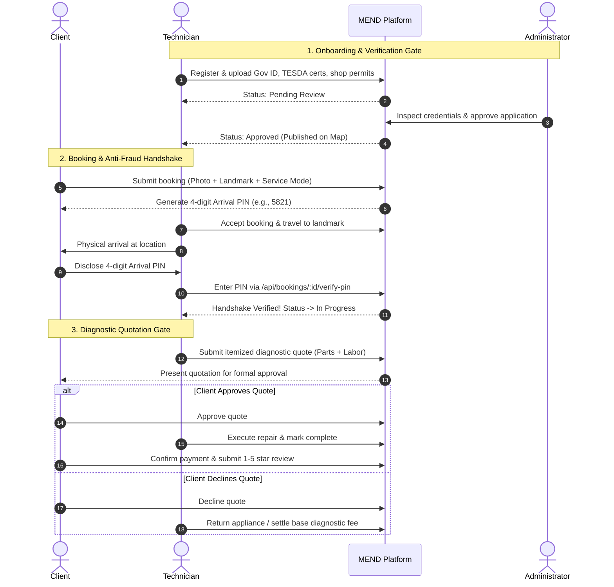

# MEND — Maintenance Experts Near you Door

> **Comprehensive System Architecture, Problem Analysis, and Real-Life Solution Matrix**  
> *Target Region:* Ilocos Norte, Philippines
> *Stack:* React 19 PWA, Node.js Express API, Supabase (PostgreSQL + Auth + Storage), Mapbox GL, PayMongo  

---

## 1. Executive Summary & System Overview

**MEND** is an service marketplace engineered to bridge the trust, safety, and logistical gap between everyday households/appliance owners and verified local repair technicians (**Repair Pros**).

In provincial and semi-urban settings like Ilocos Norte, appliance and electronics repair has historically been trapped in an informal, unregulated word-of-mouth economy. MEND digitizes, standardizes, and secures this lifecycle through:

1. **Multi-Service Fulfillment**: Home Service (on-site repair), Pickup & Delivery, and Walk-In (customer drop-off at workshop).
2. **Mandatory Credential Vetting**: Administrative review of Government IDs, TESDA trade certifications, and shop permits before any technician is dispatched.
3. **Anti-Fraud & Proof-of-Arrival Handshake**: 4-digit arrival handshake PINs, mandatory fault photos, landmark descriptions, and customer reliability scoring to eliminate fake/ghost bookings.
4. **Diagnostic-to-Quotation Pipeline**: Built-in two-stage repair flow requiring itemized customer sign-off (parts + labor) before physical work begins, eliminating hidden fees.
5. **Operational Accountability**: Real-time direct messaging, dispute ticket management with full evidentiary audit trails, customer rating/review engine, and automated technician wallet balances.

---

## 2. Real-Life Problems the System Solves

```
                             THE MARKET GAP
   INFORMAL REALITY                                      MEND PLATFORM
 ┌─────────────────────────┐                           ┌─────────────────────────┐
 │ • Unvetted strangers    │                           │ • Verified TESDA pros   │
 │ • Price gouging         │   ───────────────►        │ • Itemized quotes       │
 │ • Ghost / fake bookings │     REPLACES              │ • 4-digit Handshake PIN │
 │ • Disappearing techs    │                           │ • Audit logs & reviews  │
 └─────────────────────────┘                           └─────────────────────────┘
```

### A. Real-Life Problems Faced by Clients (Households & Appliance Owners)

> [!WARNING]
> **The "Stranger in My House" Safety Hazard**  
> Large appliances (refrigerators, split-type air conditioners, washing machines) cannot easily be transported and require "Home Service." In the informal market, homeowners must invite an unvetted stranger found on Facebook into their private residence with no identity records, background checks, or recourse in case of theft or damage.

1. **Diagnostic Extortion & Hidden Pricing**:
   - Technicians often quote a low inspection fee, dismantle the unit, and then demand exorbitant amounts for replacement parts or reassembly while the machine sits in pieces.
   - Customers have no prior visibility into standard labor rates or actual component market prices.
2. **Disappearing Technicians on "Back Jobs"**:
   - When an appliance breaks down again 48 hours later, informal handymen frequently ignore calls, block phone numbers, or refuse to honor verbal warranties (*"walang resibo, walang warranty"*).
3. **Skill Mismatch & Damaged Valuables**:
   - General handymen often claim expertise in modern inverter appliances or micro-electronics without proper training. Incompetent attempts frequently ruin costly control boards or create fire hazards.
4. **Geographic & Scheduling Friction**:
   - Finding out which technician is available today and willing to travel to an outlying or coastal barangay requires dozens of phone calls with unpredictable response times.

---

### B. Real-Life Problems Faced by Repair Professionals (Technicians)

> [!CAUTION]
> **Ghost Bookings & Ruinous Fuel Costs**  
> In provincial areas, technicians travel long distances on motorcycles across rural, unpaved roads. A prank call or a customer who hires someone else without cancelling costs the technician 1–2 hours of travel and substantial fuel expenses—erasing their profit margin for the entire day.

1. **Unfair Payment Disputes & Scope Creep**:
   - Customers often refuse to pay agreed diagnostic or labor fees once an issue is identified, claiming *"madali lang pala, 10 minutes lang ginawa mo"* while ignoring years of specialized trade skill and diagnostic equipment investment.
2. **Lack of Marketing & Digital Visibility**:
   - Master technicians with legitimate TESDA certifications often lack digital marketing skills or advertising budgets, leaving them overshadowed by informal handymen on social media.
3. **No Verifiable Track Record**:
   - Outstanding craftsmanship cannot easily be demonstrated to new clients without a portable, verified review profile and badge system.
4. **Inefficient Travel Routes**:
   - Independent technicians frequently crisscross municipalities haphazardly instead of grouping nearby jobs geographically.

---

### C. Real-Life Problems Faced by the Local Community

* **Excessive E-Waste**: Due to the uncertainty of finding honest technicians, households often prematurely discard repairable appliances and buy cheap replacements on credit, filling regional landfills.
* **Informal Economic Exclusion**: Skilled trades remain in the untaxed, untracked cash economy without verifiable financial records, disqualifying tradespeople from micro-loans, business credit, or structured training programs.

---

## 3. What the System Does (Core Capabilities & Workflows)

### High-Level Role Architecture

| Role | Access & Key Responsibilities |
|---|---|
| **Client** | Interactive Map search, booking creation with fault photos & landmarks, arrival PIN generation, quotation approval/decline, live chat, reviews. |
| **Technician (Repair Pro)** | Credential verification submission, real-time availability toggle, booking dispatch manager, 4-digit PIN verification, digital diagnostic quotation drafting, wallet & earnings dashboard. |
| **Administrator** | Technician credential inspection (approve/reject), user management (suspend/ban), dispute resolution, bug tracking, and platform sentiment monitoring. |
| **Super Administrator** | Staff management, administrative role assignment, platform financial analytics, and system audit logs. |

---

### End-to-End Operational Workflow



---

## 4. Anti-Fraud & Operational Integrity Framework

MEND enforces multiple safeguards designed specifically for the failure points of on-demand provincial marketplaces:

```
┌────────────────────────────────────────────────────────────────────────┐
│                      MEND ANTI-FRAUD FRAMEWORK                         │
├──────────────────────────┬─────────────────────────────────────────────┤
│ 1. Mandatory Photo Proof │ Prevents spam and frivolous text bookings.  │
├──────────────────────────┼─────────────────────────────────────────────┤
│ 2. Landmark Precision    │ Eliminates lost technicians in rural areas. │
├──────────────────────────┼─────────────────────────────────────────────┤
│ 3. Active Booking Limits │ New clients are limited to 1 active job.    │
├──────────────────────────┼─────────────────────────────────────────────┤
│ 4. 4-Digit Arrival PIN   │ Proves physical meeting & stops fake claims.│
├──────────────────────────┼─────────────────────────────────────────────┤
│ 5. Three-Strikes Rule    │ 3 no-shows permanently bans Home Service.   │
├──────────────────────────┼─────────────────────────────────────────────┤
│ 6. Itemized Quote Gate   │ Customer must sign off on parts + labor.   │
└──────────────────────────┴─────────────────────────────────────────────┘
```

> [!TIP]
> **The 4-Digit Arrival Handshake PIN**  
> Generated securely upon booking confirmation and visible **only** on the customer's device. When the technician arrives, the customer shares the PIN. Entering it into the technician's app unlocks the job and advances the status to `in_progress` or `item_on_hand`. This cryptographically proves physical presence and disproves claims of ghost technicians or no-show customers.

---

## 5. Technical Architecture & Security Model

* **Frontend**:
  * React 19 + TypeScript + Vite.
  * Tailwind CSS v4 design system with dark/light theme support.
  * PWA architecture: Service workers, offline resilience, and Web Push notifications.
  * Mapbox GL integration with category-based color-coded pins, radius filters, and interactive popups.
* **Backend API**:
  * Node.js + Express with TypeScript.
  * **RSA-OAEP + AES-256-GCM Hybrid Encryption**: Sensitive credentials, payload data, and verification documents are encrypted in transit.
  * Rate-limiting via `express-rate-limit` (20 req / 15 min on auth routes) and Cloudflare WAF edge protection.
* **Database & Persistence**:
  * Supabase PostgreSQL with Row Level Security (RLS) guaranteeing strict data isolation.
  * Private encrypted storage buckets for government identification documents and licenses.
  * Real-time subscriptions for instant chat messaging and booking lifecycle alerts.

---

## 6. Summary Comparison: Before vs. After MEND

| Dimension | Traditional Informal Market | With MEND |
|---|---|---|
| **Safety & Trust** | Unidentified strangers in private homes; zero verification | Government ID & TESDA certified pros verified by platform admins |
| **Pricing** | Unregulated price gouging, surprise add-ons | Transparent base rates + itemized diagnostic quotation sign-off |
| **Customer No-Shows** | Technicians waste fuel and time traveling to ghost bookings | Mandatory photo proof, landmark precision, and arrival PIN handshake |
| **Dispute Resolution** | No recourse; blocked phone numbers and lost contact | Admin evidence review (chat logs, timestamps, photos, quotes) |
| **Service Modes** | Vague arrangements; unclear pickup vs. drop-off | Explicit options: *Home Service*, *Pickup & Delivery*, *Walk-In* |
| **Financial Tracking** | Untracked physical cash only | Digital wallet balances, commission tracking, dispute refund adjustments |

---
